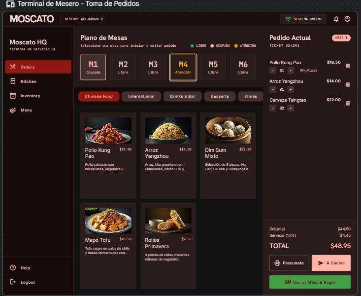
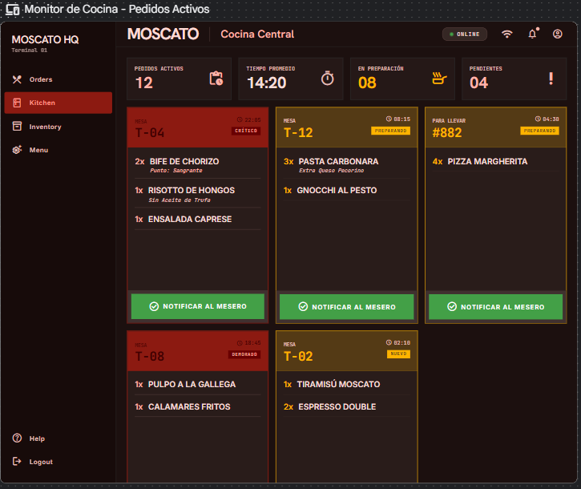
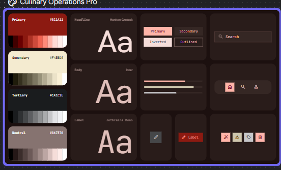
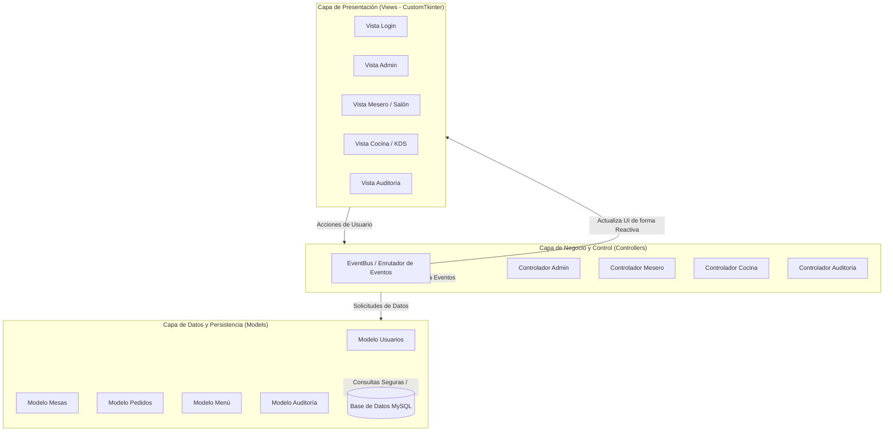

<div align="center">

# 🍷 Moscato System
### Sistema Integral de Gestión de Restaurantes, Punto de Venta (POS) y Cocina (KDS)

[](https://www.python.org/)
[](https://customtkinter.tomschimansky.com/)
[](https://www.mysql.com/)
[](#-arquitectura-del-sistema)
[](.github/workflows/ci.yml)
[](LICENSE)

<p align="center">
  <b>Solución de escritorio moderna, modular y escalable para la automatización operativa de restaurantes.</b><br>
  Soporta estaciones en tiempo real para <i>Administración</i>, <i>Salón/Meseros</i> y <i>Cocina (KDS)</i> conectadas sobre red de área local (LAN).
</p>

<p align="center">
  <a href="README.md"><b>English</b></a> • <b>Español</b>
</p>

</div>

---

## 📸 Demostración Visual de la Interfaz

| Terminal de Meseros (Toma de Pedidos y Plano de Mesas) | Monitor de Cocina (Kitchen Display System - KDS) |
| :---: | :---: |
|  |  |

<div align="center">

| Sistema de Diseño y Guía de Estilos UI (Dark Theme) |
| :---: |
|  |

</div>

---

## 🌟 Características Principales

### 🍽️ Terminal de Salón / Meseros (POS)
* **Plano interactivo de mesas:** visualización en tiempo real del estado de cada mesa (`Libre`, `Ocupada`, `Atención`).
* **Catálogo táctil con categorías:** filtrado por categorías de platos, bebidas y postres con imágenes optimizadas.
* **Comandas y personalización:** especificación de cantidades, notas especiales (ej. *sin picante*, *término de carne*), cálculo automático de subtotales, recargo de servicio (10%) e importes totales.
* **Flujo de precuenta y cobro:** emisión de precuenta y cierre de mesas con soporte para múltiples métodos de pago (Efectivo, Tarjeta, Transferencia/Pago Móvil).

### 🍳 Sistema de Pantalla de Cocina (KDS - Kitchen Display System)
* **Monitoreo en tiempo real:** recepción instantánea de pedidos enviados desde el salón sin recarga de pantalla.
* **Control de tiempos y criticidad:** cronómetros activos por comanda con semaforización de urgencia (`NUEVO`, `PREPARANDO`, `DEMORADO`, `CRÍTICO`).
* **Notificaciones de despacho:** confirmación de platos listos y notificación inmediata a meseros.

### 🛡️ Panel de Administración y Seguridad
* **Control de Acceso Basado en Roles (RBAC):** permisos diferenciados para Administradores, Meseros y Personal de Cocina.
* **Gestión de menú y precios:** altas, bajas y modificaciones de productos, precios y categorías.
* **Administración de mesas:** configuración dinámica del aforo y distribución de mesas del restaurante.
* **Gestión de usuarios:** control de credenciales y perfiles de empleados.

### 📋 Módulo de Auditoría y Trazabilidad
* Registro detallado de cada acción crítica en el sistema (`INSERTAR`, `ACTUALIZAR`, `ELIMINAR`).
* Trazabilidad completa con marcas temporales, usuario responsable, tabla afectada y desglose de cambios (ej. modificación de precios).
* Filtros avanzados por fecha, usuario, tabla y tipo de operación.

### 📊 Reportes y Exportación Analítica
* Métricas de ventas, horas de mayor afluencia y platos más solicitados.
* Exportación estructurada a **Microsoft Excel (`.xlsx`)** con formato y estilos profesionales mediante `openpyxl`.

### 🌐 Operación en Red Local (LAN)
* Arquitectura cliente-servidor para múltiples computadoras conectadas a una misma red local (Servidor central MySQL + Terminales cliente).

---

## 🏛️ Arquitectura del Sistema

El proyecto implementa el patrón **Modelo-Vista-Controlador (MVC)** desacoplado mediante un bus de eventos (**EventBus**), garantizando mantenibilidad, alta cohesión y bajo acoplamiento:



### Principios de Ingeniería Destacados:
* **Separación de Responsabilidades:** Vistas independientes del motor de base de datos; controladores actúan como intermediarios de la lógica de negocio.
* **Seguridad en Datos:** Uso de sentencias preparadas y consultas parametrizadas para prevenir inyecciones SQL.
* **Autoprovisión de Base de Datos:** La utilidad `db_config.py` verifica la existencia del esquema `moscato_db` y lo inicializa automáticamente desde `moscato.sql` en caso de no existir.
* **Tolerancia a Fallos:** Manejo defensivo de desconexiones de base de datos y reconexión configurable desde la propia interfaz gráfica.

---

## 🛠️ Tecnologías y Dependencias

| Tecnología | Propósito |
| :--- | :--- |
| **Python 3.10+** | Lenguaje de programación principal |
| **CustomTkinter** | Framework de interfaz gráfica moderna con modo oscuro nativo |
| **MySQL Connector** | Driver oficial optimizado para comunicación con MySQL Server / MariaDB |
| **Pillow (PIL)** | Procesamiento y renderizado dinámico de imágenes de productos e iconos |
| **OpenPyXL** | Generación de libros de cálculo de Excel para reportes gerenciales |
| **Darkdetect** | Detección automática del esquema de color del sistema operativo |
| **PyInstaller & Inno Setup** | Empaquetado en ejecutable independiente (`.exe`) e instalador para Windows |

---

## 🚀 Guía de Instalación y Ejecución

### 1. Requisitos Previos
* [Python 3.10 o superior](https://www.python.org/downloads/) (asegúrate de marcar *"Add python.exe to PATH"*).
* Servidor MySQL activo (por ejemplo, [XAMPP](https://www.apachefriends.org/) iniciando el servicio **MySQL**, o MySQL Server oficial).

### 2. Clonar el Repositorio
```bash
git clone https://github.com/GAM0-VE/MoscatoSystem.git
cd MoscatoSystem
```

### 3. Configurar el Entorno Virtual
```bash
# Crear entorno virtual
python -m venv venv

# Activar entorno virtual
# En Windows (PowerShell):
.\venv\Scripts\Activate.ps1
# En Windows (CMD):
.\venv\Scripts\activate.bat
# En Linux / macOS:
source venv/bin/activate

# Instalar dependencias requeridas
pip install -r requirements.txt
```

### 4. Configurar la Base de Datos
1. Inicie su servidor MySQL (ej. desde el panel de control de XAMPP).
2. Opcional: Puede importar `moscato.sql` desde phpMyAdmin o consola MySQL:
   ```bash
   mysql -u root -p < moscato.sql
   ```
   *(Nota: Si no lo importa manualmente, la aplicación detectará la ausencia de la base de datos e intentará provisionarla automáticamente al iniciar).*
3. Si su MySQL usa credenciales distintas a las estándar (host `localhost`, usuario `root`, sin contraseña), copie la plantilla y ajuste sus parámetros:
   ```bash
   # En Windows PowerShell:
   Copy-Item db_config.example.json db_config.json
   ```

### 5. Iniciar la Aplicación
```bash
python main.py
```

---

## 🔑 Credenciales de Acceso por Defecto

El esquema `moscato.sql` incluye cuentas de demostración preconfiguradas:

| Rol | Usuario | Contraseña | Capacidades |
| :--- | :--- | :--- | :--- |
| 👑 **Administrador** | `admin` | `123` | Control total, menú, precios, usuarios, mesas, reportes y auditoría |
| 🧑‍💼 **Mesero 1** | `mesero1` | `0000` | Terminal de salón: asignación de mesas y toma de pedidos |
| 🧑‍💼 **Mesero 2** | `mesero2` | `0000` | Terminal de salón secundario |
| 👨‍🍳 **Cocinero 1** | `cocinero1` | `0000` | Monitor KDS: recepción de comandas y control de tiempos |
| 👨‍🍳 **Cocinero 2** | `cocinero2` | `0000` | Monitor KDS secundario |

---

## 🧪 Pruebas Automatizadas

El proyecto cuenta con una suite de pruebas unitarias para validar la integridad de filtros, lógica de negocio y controladores:

```bash
# Ejecutar todas las pruebas unitarias
python -m unittest discover tests
```

---

## 📁 Estructura del Repositorio

```text
MoscatoSystem/
├── .github/                    # Workflows de CI/CD (GitHub Actions)
│   └── workflows/ci.yml
├── docs/                       # Documentación técnica, diagramas y screenshots
│   ├── screenshots/            # Capturas de pantalla para la documentación
│   ├── CONFIGURACION_LAN.md    # Guía de despliegue en red multi-equipo
│   └── uml_casos_uso.md        # Especificación de casos de uso y diagramas
├── src/                        # Código fuente modular (Arquitectura MVC)
│   ├── controllers/            # Controladores de lógica de aplicación
│   │   ├── admin/              # Administración general
│   │   ├── auditoria/          # Registro de auditoría
│   │   ├── cocina/             # Lógica de estación KDS
│   │   ├── mesas/              # Control de mesas y aforo
│   │   ├── pedidos/            # Gestión de órdenes y análisis
│   │   └── usuarios/           # Gestión de accesos
│   ├── core/                   # Inicialización, ventana principal y EventBus
│   ├── models/                 # Modelos de datos y consultas SQL
│   ├── utils/                  # Conexión a BD, exportador Excel, rutas
│   └── views/                  # Interfaces gráficas con CustomTkinter
├── tests/                      # Suite de pruebas automatizadas
├── .gitignore                  # Reglas de exclusión de Git
├── db_config.example.json      # Plantilla de configuración de base de datos
├── instalador.iss              # Script de compilación de instalador Inno Setup
├── LICENSE                     # Licencia de código abierto MIT
├── main.py                     # Punto de entrada de la aplicación
├── moscato.sql                 # Script DDL/DML de estructura y datos demo
├── MoscatoSystem.spec          # Especificación de empaquetado para PyInstaller
├── moscato_logo.ico            # Ícono oficial de la aplicación
├── requirements.txt            # Especificación de dependencias del proyecto
└── README.md                   # Documentación principal del proyecto
```

---

## 📦 Generación de Ejecutables (.exe) e Instalador

1. **Compilar con PyInstaller:**
   ```bash
   pyinstaller MoscatoSystem.spec
   ```
2. **Generar Instalador con Inno Setup:**
   Abra `instalador.iss` con Inno Setup Compiler y compile el proyecto. El instalador resultante se generará en la carpeta `Instalador/`.

> **Nota para usuarios finales:** Puede descargar el instalador precompilado listo para Windows directamente desde la sección de **[Releases](https://github.com/GAM0-VE/MoscatoSystem/releases)** de este repositorio.

---

## 📄 Licencia

Este proyecto está bajo la Licencia **MIT**. Consulte el archivo [LICENSE](LICENSE) para más detalles.

---

## 👨‍💻 Autor

**Manuel Castro**  
*Desarrollador de Software | Python & Sistemas de Escritorio / Backend*

* **GitHub:** [@GAM0-VE](https://github.com/GAM0-VE)
* **LinkedIn:** [Manuel Castro](https://linkedin.com/) *(Actualiza con tu perfil)*
* **Email:** [castellano.manuel@email.com](mailto:castellano.manuel@email.com)

