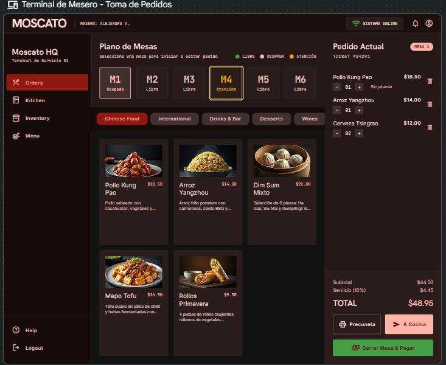
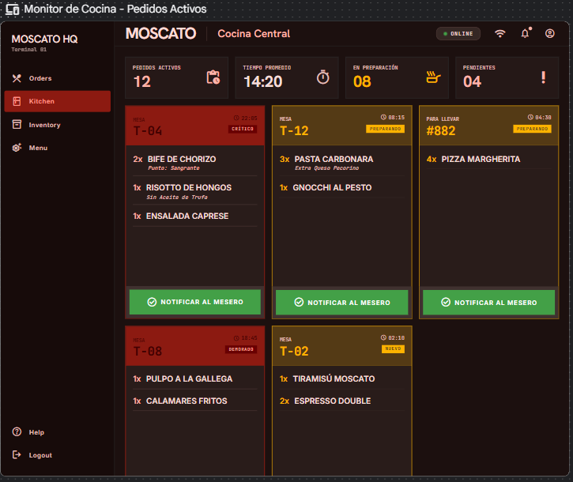
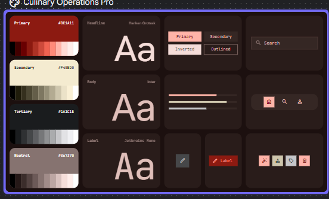
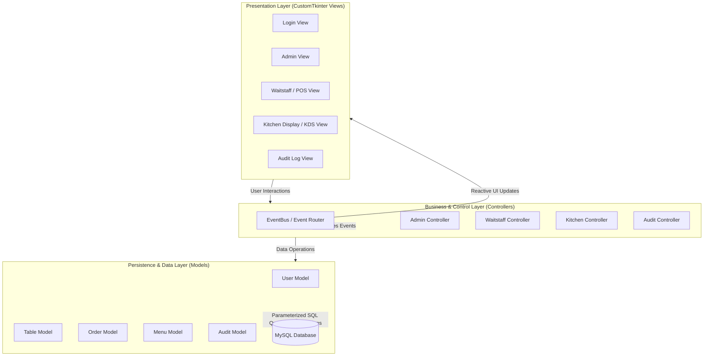

<div align="center">

# 🍷 Moscato System
### Comprehensive Restaurant Management, Point of Sale (POS) & Kitchen Display System (KDS)

[](https://www.python.org/)
[](https://customtkinter.tomschimansky.com/)
[](https://www.mysql.com/)
[](#-system-architecture)
[](.github/workflows/ci.yml)
[](LICENSE)

<p align="center">
  <b>A modern, modular, and scalable desktop software solution engineered for restaurant operations automation.</b><br>
  Supports multi-station workflows across <i>Administration</i>, <i>Front-of-House / Waitstaff</i>, and <i>Kitchen (KDS)</i> over a Local Area Network (LAN).
</p>

<p align="center">
  <b>English</b> • <a href="README.es.md"><b>Español</b></a>
</p>

</div>

---

## 📸 Visual Showcase

| Waitstaff Terminal (Interactive Table Plan & Order Taking) | Kitchen Display System (KDS Monitor & Prep Timers) |
| :---: | :---: |
|  |  |

<div align="center">

| UI Design System & Dark Theme Style Guide |
| :---: |
|  |

</div>

---

## 🌟 Key Features

### 🍽️ Front-of-House / Waitstaff Terminal (POS)
* **Interactive Floor Plan:** Real-time visual tracking of table occupancy states (`Available`, `Occupied`, `Attention Required`).
* **Visual Menu Catalog:** Touch-optimized dish and beverage selection with category filtering and dynamic thumbnail rendering.
* **Order Customization & Item Modifiers:** Detailed kitchen notes (e.g., *no spicy*, *meat cooking degree*), item quantity increments/decrements, automatic subtotaling, 10% service charge computation, and grand totals.
* **Guest Check & Payment Processing:** Instant pre-bill calculation, invoice printing simulation, and table settlement supporting multiple tender types (Cash, Debit/Credit Card, Bank Transfer).

### 🍳 Kitchen Display System (KDS)
* **Real-time Ticket Synchronization:** Direct comanda routing from waitstaff floor terminals without polling lag or manual screen refreshes.
* **Ticket Elapsed Time & Urgency Alerting:** Active preparation timers with color-coded severity stages (`NEW`, `PREPARING`, `DELAYED`, `CRITICAL`).
* **Expedite & Dispatch Notifications:** One-click ticket completion notifying floor staff that courses are ready for pickup.

### 🛡️ Administrative Control & Security (RBAC)
* **Role-Based Access Control:** Strict permission segregation between Administrators, Floor Waitstaff, and Kitchen Crews.
* **Menu Catalog & Pricing Management:** Full CRUD management of items, price points, descriptions, and categories.
* **Seating Capacity Configuration:** Dynamic layout adjustments and table management.
* **User & Credential Management:** Secure employee credential setup and access revocation.

### 📋 Audit Trail & Compliance Logging
* Comprehensive operation recording on all critical business transactions (`INSERT`, `UPDATE`, `DELETE`).
* Complete traceability capturing exact timestamps, responsible employee, affected table, and explicit delta changes (e.g., historical price adjustments).
* Multi-parameter filter engine by date range, user account, database table, and operation type.

### 📊 Business Analytics & Excel Export Engine
* Operational reporting on revenue streams, peak service hours, and product demand rankings.
* Formatted **Microsoft Excel (`.xlsx`)** generation with styled headers and automated data serialization using `openpyxl`.

### 🌐 Multi-Station Local Area Network (LAN) Operation
* Distributed client-server deployment over local Wi-Fi or Ethernet: single centralized MySQL host serving concurrent client stations.

---

## 🏛️ System Architecture

The application adopts the **Model-View-Controller (MVC)** architectural pattern decoupled via an **EventBus** (publish-subscribe pattern), fostering maintainability, high cohesion, and low coupling:



### Engineering Highlights:
* **Separation of Concerns:** Views remain agnostic of database operations; controllers coordinate business workflows and domain rules.
* **Defensive Security:** Parameterized queries and prepared statements across all models prevent SQL injection vulnerabilities.
* **Self-Healing Database Provisioning:** `src/utils/db_config.py` verifies database existence at startup and automatically provisions the schema and seed data from `moscato.sql` if missing.
* **Fault-Tolerant Networking:** Resilient connection handling with inline graphical connection reconfiguration if the host IP changes.

---

## 🛠️ Tech Stack & Dependencies

| Component | Technology | Description |
| :--- | :--- | :--- |
| **Language** | Python 3.10+ | Core application runtime |
| **GUI Framework** | CustomTkinter | Modernized UI library with native dark/light mode support |
| **Database Driver** | `mysql-connector-python` | Official high-performance MySQL driver |
| **Image Processing** | Pillow (PIL) | Dynamic asset loading, thumbnail caching, and resizing |
| **Data Export** | OpenPyXL | Programmatic Excel spreadsheet generation |
| **System Theme** | Darkdetect | OS-level color scheme detection |
| **Packaging** | PyInstaller & Inno Setup | Standalone Windows executable and installer build scripts |

---

## 🚀 Quickstart & Installation

### 1. Prerequisites
* [Python 3.10+](https://www.python.org/downloads/) (ensure *"Add python.exe to PATH"* is checked during installation).
* Running MySQL Server instance (e.g., [XAMPP](https://www.apachefriends.org/) with MySQL service running, or native MySQL Server 8.0+).

### 2. Clone the Repository
```bash
git clone https://github.com/GAM0-VE/MoscatoSystem.git
cd MoscatoSystem
```

### 3. Set Up Virtual Environment
```bash
# Create virtual environment
python -m venv venv

# Activate virtual environment
# Windows (PowerShell):
.\venv\Scripts\Activate.ps1
# Windows (CMD):
.\venv\Scripts\activate.bat
# Linux / macOS:
source venv/bin/activate

# Install required dependencies
pip install -r requirements.txt
```

### 4. Database Configuration
1. Ensure your MySQL server is running.
2. *(Optional)* Import `moscato.sql` via phpMyAdmin, MySQL Workbench, or CLI:
   ```bash
   mysql -u root -p < moscato.sql
   ```
   *(Note: If skipped, the application detects the missing database on launch and automatically initializes it).*
3. If your MySQL server uses custom credentials (non-default port, password, or remote host), copy the template and edit accordingly:
   ```powershell
   # Windows PowerShell:
   Copy-Item db_config.example.json db_config.json
   ```

### 5. Launch the Application
```bash
python main.py
```

---

## 🔑 Default Demo Credentials

The database script `moscato.sql` bundles preconfigured seed accounts for evaluation:

| Role | Username | Password | Access Scope |
| :--- | :--- | :--- | :--- |
| 👑 **Administrator** | `admin` | `123` | Full access: menu, pricing, staff, seating, audit logs, and reports |
| 🧑‍💼 **Waitstaff 1** | `mesero1` | `0000` | Floor POS: table assignment, order creation, pre-bills |
| 🧑‍💼 **Waitstaff 2** | `mesero2` | `0000` | Floor POS secondary station |
| 👨‍🍳 **Kitchen Staff 1**| `cocinero1`| `0000` | KDS Terminal: active orders, prep timers, expedite dispatch |
| 👨‍🍳 **Kitchen Staff 2**| `cocinero2`| `0000` | KDS Terminal secondary station |

---

## 🧪 Automated Testing

A suite of unit tests validates controller business logic, date formatting, and filter operations:

```bash
# Run unit test suite
python -m unittest discover tests
```

---

## 📁 Repository Structure

```text
MoscatoSystem/
├── .github/                    # CI/CD pipelines (GitHub Actions)
│   └── workflows/ci.yml
├── docs/                       # Technical documentation, UML & screenshots
│   ├── screenshots/            # Documentation UI previews
│   ├── CONFIGURACION_LAN.md    # LAN multi-terminal deployment guide
│   └── uml_casos_uso.md        # Use case diagrams and system specifications
├── src/                        # Modular source code (MVC Architecture)
│   ├── controllers/            # Application logic controllers
│   │   ├── admin/              # Management operations
│   │   ├── auditoria/          # Audit trail logging
│   │   ├── cocina/             # Kitchen display logic
│   │   ├── mesas/              # Seating and table management
│   │   ├── pedidos/            # Orders and operational analytics
│   │   └── usuarios/           # User authorization and RBAC
│   ├── core/                   # Application lifecycle, main window & EventBus
│   ├── models/                 # Data access layer & SQL transactions
│   ├── utils/                  # DB connection pool, Excel exporter, path utilities
│   └── views/                  # Modern CustomTkinter graphical views
├── tests/                      # Automated unit test suite
├── .gitignore                  # Git exclusion rules
├── db_config.example.json      # Database configuration template
├── instalador.iss              # Inno Setup Windows installer compiler script
├── LICENSE                     # MIT Open Source License
├── main.py                     # Application bootstrap entrypoint
├── moscato.sql                 # DDL/DML database schema and seed dataset
├── MoscatoSystem.spec          # PyInstaller executable packaging spec
├── moscato_logo.ico            # Official application brand icon
├── requirements.txt            # Python dependencies specification
├── README.es.md                # Spanish documentation
└── README.md                   # English documentation (Primary)
```

---

## 📦 Building Executables & Installer

1. **Bundle standalone executable with PyInstaller:**
   ```bash
   pyinstaller MoscatoSystem.spec
   ```
2. **Compile installer with Inno Setup:**
   Open `instalador.iss` inside Inno Setup Compiler and build the setup wizard. The compiled installer will be saved to `Instalador/Instalar_Moscato.exe`.

> **End Users:** You can download the precompiled Windows installer directly from the **[Releases](https://github.com/GAM0-VE/MoscatoSystem/releases)** section of this repository.

---

## 📄 License

This project is open-source and distributed under the **MIT License**. See the [LICENSE](LICENSE) file for complete details.

---

## 👨‍💻 Author

**Manuel Castro**  
*Software Developer | Python & Desktop Systems / Backend*

* **GitHub:** [@GAM0-VE](https://github.com/GAM0-VE)
* **LinkedIn:** [Manuel Castro](https://linkedin.com/) *(Update with your URL)*
* **Email:** [castellano.manuel@email.com](mailto:castellano.manuel@email.com)
