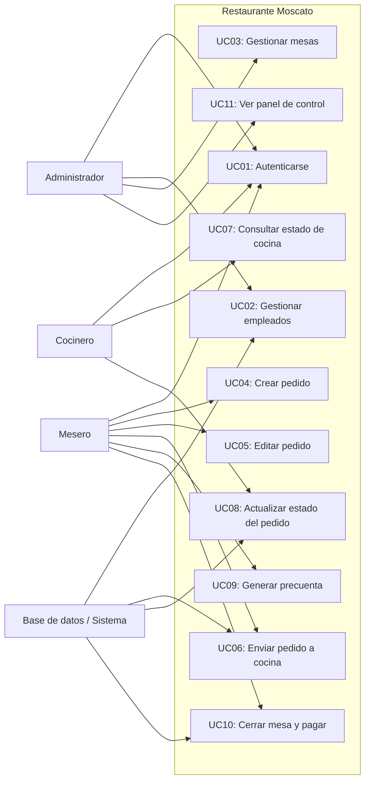

# UML de Casos de Uso - Restaurante Moscato

Este documento presenta una versión más formal del modelo de casos de uso para el sistema de gestión de pedidos del restaurante.

## 1. Actores
- Administrador: gestiona usuarios, mesas y el panel de control.
- Mesero: crea y modifica pedidos, los envía a cocina y gestiona cuentas.
- Cocinero: visualiza pedidos y actualiza su estado.
- Sistema / Base de datos: almacena y consulta la información del negocio.

## 2. Casos de uso principales
- UC01: Autenticarse
- UC02: Gestionar empleados
- UC03: Gestionar mesas
- UC04: Crear pedido
- UC05: Editar pedido
- UC06: Enviar pedido a cocina
- UC07: Consultar estado de cocina
- UC08: Actualizar estado del pedido
- UC09: Generar precuenta
- UC10: Cerrar mesa y pagar
- UC11: Ver panel de control y estadísticas

## 3. Relación actores-casos de uso
- Administrador participa en UC01, UC02, UC03, UC11.
- Mesero participa en UC01, UC04, UC05, UC06, UC09, UC10.
- Cocinero participa en UC01, UC07, UC08.
- El sistema participa como soporte en UC02, UC06, UC08 y UC10.

## 4. Diagrama en Mermaid

